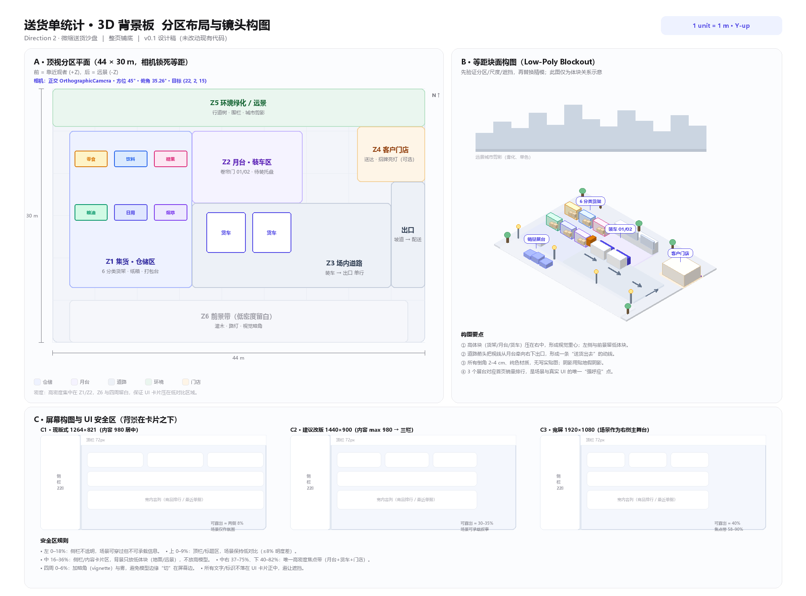
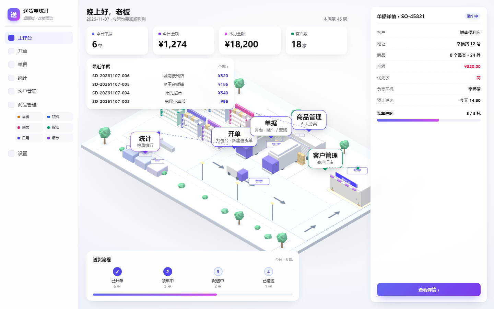

# 送货单统计 · 3D 背景板 场景规格书

| 项目 | 内容 |
|---|---|
| 文档 | 场景规格书 / Scene Spec |
| 版本 | v0.8（P5 沙盘卡片 + 实时指标 + 分类商品数 + 3D 点选入口） |
| 日期 | 2026-11-07 |
| 方向 | Direction 2 · 微缩送货沙盘 |
| 形态 | 工作台内的**沙盘卡片**（有界模块，非整页铺底） |
| 状态 | **P5：3D 已成为工作台的「沙盘卡片」模块（默认关闭）** |

> 配套文件： [分区布局图](./layout.png) · [模型清单 CSV](./model-list.csv) · [布局图生成脚本](./scripts/gen_layout.py)

---

## 0. 摘要（TL;DR）

在白色工作台之下铺一层**等距、低多边形、纯色柔和**的微缩送货沙盘：左侧集货仓储、中部月台装车、右侧场内道路与客户门店，一条「集货 → 装车 → 上路 → 送达」的动线贯穿画面。场景 44 × 30 m，正交相机锁死 45°/35.26°，总面数控制在 **6–9 万三角面**，用数据（今日单据数、本月金额、销量前三、客户数）驱动箱堆、货车、货架与展台，静止时停帧、低端机降级为静态图。它承担氛围与叙事，不承载必须点击的信息。

---

## 1. 范围与前提

1. **整页铺底**：一块 `position: fixed; inset: 0; z-index: -1`（或内容层之下）的透明 Canvas，UI 卡片浮在其上；侧栏、顶栏保持不透明。
2. **非交互主场景**：不做自由旋转/缩放/漫游；只保留轻微鼠标视差与 hover 高亮。所有业务操作仍在原 DOM UI 完成。
3. **零侵入**：本文档阶段只新增 `docs/` 设计资料。后续落地时以**独立模块 + 动态加载**接入，加载失败时页面照常可用。
4. **性能优先**：目标中端核显 1440×900 稳定 60fps；提供移动端/低端机静态图降级。
5. **数据诚实**：只使用现有 `Store` 已有字段（见 §9），不臆造不存在的状态；为未来字段预留扩展位。

---

## 2. 设计定调

参考图成立的核心不是"仓库"，而是三件事：**等距视角 + 低模纯色 + 一条可读的货物流**。据此定五条原则：

| # | 原则 | 具体做法 |
|---|---|---|
| 1 | 等距锁死 | 正交相机，方位 45°、俯角 35.26°，全场景不透视变形 |
| 2 | 低模纯色 | 圆角倒角几何体 + 纯色材质，无写实贴图；阴影用贴地假阴影 |
| 3 | 一条动线 | 货从左上集货区进、经月台装车、沿道路向右下出口离开，视线有落点 |
| 4 | 服务 UI | 背景整体降饱和、降对比；高体块只放右侧焦点带，卡片区只留低体块 |
| 5 | 品牌一致 | 用项目自己的**靛蓝—紫**品牌色，不用参考图的蓝；只借构图语言 |

---

## 3. 品牌与色彩

取色自项目 `styles.css` 的 `:root`：

| Token | 色值 | 场景用途 |
|---|---|---|
| 主靛 | `#4F46E5` / `#6366F1` | 货车车头、月台门框、关键标识 |
| 紫 | `#7C3AED` | 门店雨棚、氛围点缀 |
| 品红 | `#D946EF` | 仅极小面积高光（如招牌霓虹），≤2% |
| 纸白 | `#F7F7FA` | 沙盘底座、建筑墙面 |
| 墨 | `#09090B` | 文字/线条（模型上极少用） |
| 线 | `#E4E4E7` | 地坪分割、描边 |
| 绿 | `#059669` | 绿化带（降饱和到 `#6FBF8B` 级别） |
| 琥珀 | `#D97706` | 叉车、警示标识（小面积） |

**规则**：3D 场景整体把饱和度压到 UI 的 **70–80%**、明度差控制在 **≤ 12%**，确保白色卡片和深色文字始终是视觉第一层。场景内同色系不超过 5 个色相。

---

## 4. 坐标、尺度与工程约定

| 项 | 约定 |
|---|---|
| 单位 | 1 unit = 1 米（与 three.js 场景一致，导出 GLB 不改缩放） |
| 轴向 | Y 向上；+X 向右（东）；+Z 朝向观者（前/近）；−Z 为远景 |
| 场地 | 44（X）× 30（Z）m；底座外扩到 46 × 32 m |
| 地面 | y = 0；地贴/道路 y = 0.02–0.05；模型不得低于 y = 0 |
| Pivot | 所有模型轴心在**底面中心**，正面朝 **−Z** |
| 层级 | 地面(0) → 道路/地贴(0.03) → 低体块(托盘/箱) → 高体块(货架/货车/建筑) → 标签(3.5 以上) |
| 命名 | `类别-对象-序号`，如 `VEH-TRUCK-01`、`CAT-POD-02`（详见 §8/CSV） |

---

## 5. 场景分区（Z0–Z6）



| 区 | 范围 (x, z) | 内容 | 视觉权重 | 业务对应 |
|---|---|---|---|---|
| **Z0 底座** | 全场地 0–44 / 0–30（外扩 1 m） | 圆角沙盘底座 + 柔和投影 | — | 让场景"浮"在页面上 |
| **Z1 集货·仓储** | x 2–16.5, z 5–23.5 | 6 分类货架（CAT-POD-01..06）、纸箱、打包台、单据夹 | 高（中景） | 商品库 / 待送货物 |
| **Z2 月台·装车** | x 16.5–29.5, z 5–13.5 | 卷帘门 01/02、两辆货车、待装托盘、叉车 | **最高（主焦点）** | 今日单据 / 装车 |
| **Z3 场内道路** | x 16.5–40, z 13.5–23.5 | 单行道路、箭头、地贴 | 低 | 单据流转 |
| **Z4 客户门店** | x 36–44, z 4.5–11 | 小门店、招牌（夜间亮灯，可选） | 中 | 客户管理 |
| **Z5 环境远景** | z 0–4.5 及外侧 | 行道树、围栏、路灯、城市剪影 | 极低（雾化） | 氛围 |
| **Z6 前景带** | x 2–42, z 25–30 | 灌木、路灯、三级展台、视觉暗角 | 低 | 销量排行呼应 |

**版面锚点（改版三栏 1440）**：左侧侧栏约 16%、右侧详情约 25%，顶部 9%、底部 18% 为界面区。主焦点（月台 + 两辆货车）落在中间 **x 37–75% 的安全带**内（约 50–62%），门店约 72–78%；背景在界面区只放低体块，避免压住卡片与文字。

---

## 6. 相机与视口

| 参数 | 值 |
|---|---|
| 类型 | `OrthographicCamera`（正交，无透视） |
| 目标点 | `(22, 2.0, 15)`（场地几何中心略抬高） |
| 方向向量 | `normalize(1, 1, 1)` → 方位 45°、俯角 35.264° |
| 相机位置 | `target + dir * 60`（正交下距离只影响裁剪，不影响大小） |
| 近/远裁剪 | 0.1 / 200 |
| 设计视高 | `FRUSTUM_H = 34 m`（垂直可视高度） |
| 水平视宽 | `FRUSTUM_H * aspect`（随窗口自适应） |
| 像素比 | `min(devicePixelRatio, 2)`；低端机 1.25 |
| 交互 | 无 orbit；鼠标视差 ±1.5°（阻尼 0.08），`reduced-motion` 时关闭 |

**响应式策略**

| 视口宽 | 处理 |
|---|---|
| ≥ 1600 | `FRUSTUM_H = 34`，场景居中偏右（`target.x + 1`） |
| 1200–1600 | `FRUSTUM_H = 34`，标准构图 |
| < 1200 | `FRUSTUM_H = 34 * (1200 / width)`，整体缩小，保证 44 m 全宽可见 |
| 超宽 (≥ 21:9) | `FRUSTUM_H = 40`，`target.x − 2`，把道路/远景铺到两侧 |

> 分辨率变化只改正交视锥的 left/right/top/bottom，**不移动相机、不改视角**，避免破坏等距关系。

---

## 7. 灯光、渲染与后处理

| 灯光 | 参数 | 作用 |
|---|---|---|
| 环境光 `AmbientLight` | `#FFFFFF`, 0.35 | 抬高暗部，避免死黑 |
| 半球光 `HemisphereLight` | 天 `#EAF2FF` / 地 `#C9D4E5`, 0.9 | 整体天光，柔和过渡 |
| 主平行光 `DirectionalLight` | `#FFF6E8`, 1.1，方向 `(-0.6, 1, 0.4)` | 主明暗与方向感 |

**渲染设置**

- `renderer = new WebGLRenderer({ antialias: true, alpha: true, powerPreference: 'high-performance' })`
- `outputColorSpace = SRGBColorSpace`；`toneMapping = ACESFilmicToneMapping`，`exposure ≈ 1.0`
- **不开启实时阴影贴图**：统一用「径向渐变贴地假阴影」平面（每物体一张，合并进图集），必要时叠加烘焙 AO 到顶点色。
- 雾：`Fog(#F4F7FC, 70, 150)`，只让远景城市消失，不雾化主体。
- 背景：Canvas 透明，页面 CSS 用径向渐变 `#FFFFFF → #F1F4FA` 兜底；避免与场景天空重复。
- 后处理：仅按需 FXAA；**不做 Bloom**（发光招牌用自发光材质 + 小贴片即可），保证低端可跑。

---

## 8. 模型清单

字段说明：**面数**为目标 LOD0 三角面；**实例化**指同模型批量复用；**动效**指是否参与动画；**绑定**指是否随数据变化。

| ID | 模型 | 类别 | 尺寸 L×W×H (m) | 面数 | LOD | 实例化 | 动效 | 数据绑定 | 优先级 |
|---|---|---|---|---|---|---|---|---|---|
| ENV-BASE-01 | 沙盘底座（圆角） | 环境 | 46×32×0.6 | 800 | — | — | 入场 | — | P0 |
| ENV-GROUND-01 | 地坪与分区地面 | 环境 | 44×30 | 200 | — | — | — | 分区色 | P0 |
| ENV-ROAD-01 | 场内道路与标线 | 环境 | 24×10 | 400 | — | — | — | — | P0 |
| WH-DOCK-01 | 月台 + 卷帘门 01/02 | 建筑 | 13×2×3 | 2600 | LOD0/1 | — | 门可开（预留） | 今日单据 | P0 |
| CAT-POD-01 | 休闲零食类货架 | 商品分类 | 3.9×1.9×2.95 | 600 | LOD0/1 | 6 组复用 | 点击高亮 | 分类库存 | P0 |
| CAT-POD-02 | 酒水饮料类货架 | 商品分类 | 3.9×1.9×2.95 | 600 | LOD0/1 | 同上 | 点击高亮 | 分类库存 | P0 |
| CAT-POD-03 | 糖果巧克力类货架 | 商品分类 | 3.9×1.9×2.95 | 600 | LOD0/1 | 同上 | 点击高亮 | 分类库存 | P0 |
| CAT-POD-04 | 粮油副食类货架 | 商品分类 | 3.9×1.9×2.95 | 600 | LOD0/1 | 同上 | 点击高亮 | 分类库存 | P0 |
| CAT-POD-05 | 日用百货类货架 | 商品分类 | 3.9×1.9×2.95 | 600 | LOD0/1 | 同上 | 点击高亮 | 分类库存 | P0 |
| CAT-POD-06 | 香烟烟草类货架 | 商品分类 | 3.9×1.9×2.95 | 600 | LOD0/1 | 同上 | 点击高亮 | 分类库存 | P0 |
| VEH-TRUCK-01 | 厢式货车（蓝白 + 品牌标） | 车辆 | 6.2×2.3×3.0 | 3200 | LOD0/1 | — | 驶入/驶出 | 单据量 | P0 |
| VEH-TRUCK-02 | 厢式货车 02 | 车辆 | 6.2×2.3×3.0 | 3200 | LOD0/1 | 复用 01 | 驶入/驶出 | 单据量 | P0 |
| VEH-FORKLIFT-01 | 叉车 | 车辆 | 2.4×1.2×2.0 | 2200 | LOD1 | — | 往返/举升 | 活跃度 | P0 |
| VEH-PALLET-JACK | 地牛（手动叉车） | 车辆 | 1.6×0.7×1.2 | 900 | LOD1 | — | 往返 | — | P1 |
| OBJ-PALLET | 托盘 | 货物 | 1.2×1.0×0.15 | 120 | LOD1 | Instanced | — | — | P0 |
| OBJ-CARTON | 纸箱（2–3 规格） | 货物 | 0.4–0.6 | 24 | — | Instanced | — | 单据数量 | P0 |
| OBJ-WRAP | 缠绕膜托盘组 | 货物 | 1.2×1.0×1.2 | 300 | LOD1 | Instanced | — | 货架满度 | P1 |
| PKG-TABLE-01 | 打包台 | 作业 | 3.2×1.6×1.0 | 700 | LOD1 | — | — | — | P1 |
| PKG-CONVEYOR | 传送带 | 作业 | 3.0×0.6×0.8 | 500 | LOD1 | — | UV 滚动 | — | P1 |
| PKG-SCALE | 电子秤 / 扫码台 | 作业 | 0.5×0.4×0.2 | 150 | — | — | — | — | P2 |
| DOC-CLIPBOARD | 送货单夹板 | 单据 | 0.3×0.02×0.4 | 80 | — | — | 轻微浮动 | 单号贴图 | P1 |
| DOC-BOX | 单据盒 / 纸卷 | 单据 | 0.3×0.3×0.2 | 100 | — | Instanced | — | — | P2 |
| SIGN-DOCK | 月台编号牌 01/02 | 标识 | 0.8×0.1×0.6 | 60 | — | — | — | Canvas 文字 | P1 |
| SIGN-ZONE | 分区地贴 / 立牌 | 标识 | 1.2×0.1 | 40 | — | Instanced | — | 文字贴图 | P1 |
| SIGN-ROUTE | 道路箭头 / 虚线 | 标识 | — | 30 | — | Instanced | — | — | P2 |
| ENV-LAMP | 路灯 | 环境 | 0.3×0.3×4.0 | 250 | LOD1 | ×4 | 夜间点亮 | 时间 | P2 |
| ENV-TREE | 行道树 | 环境 | 2.0–3.0 | 350 | LOD1 | ×6 | 轻微摇摆 | — | P2 |
| ENV-SHRUB | 灌木 / 花坛 | 环境 | 0.8 | 120 | — | Instanced | — | — | P2 |
| ENV-FENCE | 围栏 / 防撞柱 / 水马 | 环境 | — | 200 | — | Instanced | — | — | P2 |
| ENV-CITY | 远景城市剪影 | 远景 | 60×12 | 1200 | — | 合并 1 块 | — | — | P2 |
| ENV-SKY | 渐变天空 / 云贴片 | 远景 | — | 200 | — | — | 缓慢漂移 | 时间 | P2 |
| UI-PODIUM | 三级数据展台 | 数据 | 6×3×1.5 | 600 | — | — | 高度过渡 | 销量前三 | **P1** |
| CHAR-WORKER | 低模作业员 | 人物 | 1.75 | 500 | LOD1 | ×3 | 1–2 循环动作 | — | P2 |
| CHAR-DRIVER | 司机 | 人物 | 1.75 | 500 | LOD1 | — | 上车（预留） | — | P3 |
| FX-PARTICLE | 飞鸟 / 尘埃粒子 | 动效 | — | 60 | — | Points | 漂移 | — | P3 |

**合计（LOD0 全量）≈ 6.4 万三角面**；P0+P1 核心约 4.1 万，符合预算。完整可执行清单见 [model-list.csv](./model-list.csv)。

---

## 9. 数据绑定（只依赖现有字段）

现有订单对象字段：`no`（如 `SD-20261107-001`）、`date`、`customer`、`items`、`total`、`remark`；**当前没有"送达状态"字段**。因此按现有数据做"数量/金额/排行"映射：

| 场景表现 | 数据来源（现有 API） | 映射规则 |
|---|---|---|
| 月台待装纸箱堆数 | `Store.listOrders({ from: 今天, to: 今天 }).length` | `stacks = clamp(ceil(n / 2), 0, 12)`，每堆 0.8 m |
| 货车 01/02 是否在月台 | 今日单据数 | `n ≥ 1` 停 1 辆；`n ≥ 4` 停 2 辆；否则回车场 |
| 货架填充率 | 本月金额 `Σ o.total`（`Store.listOrders({from: mFrom, to: mTo})`） | `fill = clamp(log10(amt + 1) / log10(50000), 0, 1)`，映射箱层数 |
| 三级展台高度 / 商品模型 | 首页 `productRank`（累计销量前三） | 第 1/2/3 名 → 台高 1.2 / 0.9 / 0.7 m，贴商品名 + 数量标签 |
| 远景门店数量 | `Store.listCustomers().length` | `shops = clamp(ceil(n / 4), 1, 12)` |
| 单据夹 / 车牌号 | `allOrders[0].no` | 贴 Canvas 文字（`SD-YYYYMMDD-NNN`） |
| 昼夜光照 / 路灯 | 本地小时 `new Date().getHours()` | 6–18 白天暖光；18–6 冷光 + 路灯/招牌发光 |
| 空数据待机态 | `orders.length === 0` | 月台清空、卷帘门半开、灯光偏冷、展台降下 |

**预留扩展**：若以后订单增加 `status`（如 `pending / delivering / delivered`），可把货车变成三态状态机（月台 / 路上 / 门店），无需改场景结构，只加一个 `bindStatus()`。

**更新时机**：数据变化只发生在用户保存/删除单据、切换页面时，采用"脏标记 + 下一帧插值"（`lerp` 600 ms），**不做逐帧查询 localStorage**。

**数据适配层（P2 已实现）**：预览页提供 `loadBackup(obj)` 解析 `Store.exportJSON()` 备份，`computeFromData(orders, customers)` 计算今日/本月金额、客户数、销量前三、最近单据后调用 `applyData()`；`?data=local` 可读同源 `localStorage` 的 `sd_v1_orders / sd_v1_customers`。正式嵌入 app 时，把这两个入口替换成 `Store.listOrders({from,to})`、`Store.listCustomers()`、首页 `productRank` 即可。

---

## 9.5 3D 场景导航：6 分类 + 功能模块

### 6 个商品分类 → 场景货架

| key | 分类名称 | 场景节点 | 主色 | 点击去向（真实接入） |
|---|---|---|---|---|
| snack | 休闲零食类 | CAT-POD-01（左后） | `#D97706` | `#/products?cat=snack` |
| drink | 酒水饮料类 | CAT-POD-02（中后） | `#2563EB` | `#/products?cat=drink` |
| candy | 糖果巧克力类 | CAT-POD-03（右后） | `#DB2777` | `#/products?cat=candy` |
| grain | 粮油副食类 | CAT-POD-04（左前） | `#059669` | `#/products?cat=grain` |
| daily | 日用百货类 | CAT-POD-05（中前） | `#4F46E5` | `#/products?cat=daily` |
| tobacco | 香烟烟草类 | CAT-POD-06（右前） | `#7C3AED` | `#/products?cat=tobacco` |

> 分类 key/名称与 `views/data.js` 的 `CATS` 完全一致；旧数据 `wine/other` 的兼容映射仍由原代码处理，场景侧只认新 key。

### 功能模块 → 3D 锚点

| 左栏模块 | 3D 锚点 | 相机行为 |
|---|---|---|
| 工作台 | 全场景 | 复位到总览 |
| 开单 | 打包台 / 传送带 (7.8, 21) | 拉近 |
| 单据 | 月台 + 货车 (23, 10.5) | 拉近 |
| 统计 | 三级展台 (10.3, 26.6) | 拉近 |
| 客户管理 | 客户门店 (40, 7.6) | 拉近 |
| 商品管理 | 6 分类货架 (9.25, 11.6) | 拉近到整组 |
| 设置 | 无 | 复位 |

### 双向交互规则

1. **左栏 → 3D 指引**：点击侧栏功能或分类胶囊 → 该模块高亮为 `active` → 顶部出现「已定位：商品管理 · 酒水饮料类」指引条 → 目标地面出现呼吸焦点环 + 悬浮标签 → 正交相机**平移 + 轻微缩放**（绝不做旋转，保持等距）。
2. **3D → 功能模块**：Raycaster 命中货架/月台/门店/展台 → 向上找到带 `userData.module` 的根节点 → 触发同一套 `selectModule()` → 侧栏同步高亮，并弹出「3D 场景 → 打开『商品管理 / 饮料』」路由提示（真实接入时改为 `location.hash = '#/products?cat=drink'`）。
3. **悬停动态**：鼠标进入可点击体块 → 体块轻抬 0.16 m + 地面焦点环呼吸 → 对应聊天气泡放大 1.09 倍并变实色，出现「点击进入 →」；悬停 6 个分类货架时额外弹出大号分类气泡（如「糖果巧克力类 · 点击筛选该分类」）。
4. **标签规范**：所有模块名用 HTML 气泡覆盖层（18 px 粗体 + 12 px 副标题）+ SVG 虚线引线指向体块；气泡尺寸不随相机缩放变化，保证老板远看也清楚。
5. **空白点击**：点击空地复位到工作台总览。
6. **降级**：`prefers-reduced-motion` 时关闭环呼吸与相机缓动，只保留静态高亮。

### 9.6 P5 形态：沙盘卡片（当前实现）

3D 不再是"背景"，而是工作台里的一块**有界模块**：

| 项 | 规格 |
|---|---|
| 位置 | 首页「开送货单」按钮下方，`.home-stage` 卡片，448px 高，确保右侧入口完整可见 |
| 结构 | 左侧自适应 3D 画布 + 右侧 214px 分类面板；4 个功能按钮至少 40px 高 |
| 渲染 | `3d/scene.js` 使用容器尺寸，拾取与视差坐标也按画布自身尺寸换算 |
| 取景 | 按六座货架、月台/货车、小亭、打包台和销量台的实际模型包围盒居中，同时适配横纵比例并预留指标区域；不再固定横向视宽 |
| 实时指标 | 今日单据 / 今日金额 / 本月单据 / 客户总数。金额保留到分；无数据清空排行与真实单号标签，车辆和托盘仅为动画示意 |
| 分类计数 | 右侧 6 个分类按钮带该分类**商品数**徽标，口径与商品管理一致（6 个 CATS + `LEGACY_CAT` 旧键映射，未分类商品不计入） |
| 功能入口 | 右侧新增 4 个功能按钮（开单 / 单据 / 客户 / 统计），与 3D 里的对应物互为镜像 |
| 客户门店小亭 | 使用月台右前方的客户小亭 (30.8, 14.2) 作为客户入口，避开货车/月台点击区域；远处主门店不在卡片模式中显示 |
| 点击 3D | `OPTS.onPick(userData)` → 分类跳 `#/products?cat=xxx`，模块跳对应路由（货车/月台→`#/orders`、门店小亭→`#/customers`、打包台→`#/order/new`、销量台→`#/stats`） |
| 点击分类按钮 | 同上（`data-go="products?cat=xxx"`） |
| 悬停 | 3D 分类货架 → 右侧对应按钮高亮（`api.hovered()`）；3D 功能物 → 对应功能按钮高亮 + 左下角气泡提示「名称 · 点击进入」（`#hs-tip`）。判定必须挂在**画布捕获阶段**（`canvas.addEventListener('pointermove', …, true)`），否则宿主的 canvas 监听先执行、读到的还是上一帧的悬停状态，气泡不出现 |
| 生命周期 | 离开工作台 → 卸载画布并 `api.pause()`（不空跑）；回来 → 自动重挂并 `resume()` |
| 窄屏 | <900px 在启动、开关、路由和 resize 时统一跳过挂载；保留开启偏好，设置明确提示仅桌面宽屏显示 |
| 减少动态效果 | 响应系统偏好，静止时不连续绘制，仅在数据、尺寸或交互变化后重绘 |
| 品牌 | 保留金色 Logo；标题与货车使用品牌深蓝、金色点缀，交互强调保留靛紫，减少大面积品红 |
| 开关 | 设置 →「工作台沙盘卡片」，`localStorage: sd_v1_bg3d`，**默认关闭** |
| 兜底 | WebGL/脚本失败 → 卡片保留渐变底与分类按钮，提示"沙盘不可用" |

**为什么不再整页铺底**：单列 980px + 大白卡的版式里，铺底要么改布局（位移 14px、文字压在场景上），要么被内容完全盖住。卡片形态同时满足：不位移、不遮字、能点、能跳、有用。

---

## 10. 动效清单

| 动效 | 对象 | 触发 | 时长 / 缓动 | 幅度 |
|---|---|---|---|---|
| 入场 build-in | 全场景分组 | 首次加载 | 800 ms `easeOutCubic`，每组错峰 30 ms | 由下 0.4 m 升起 + 淡入 |
| 货车驶入/驶出 | VEH-TRUCK-01/02 | 每 40–60 s 或数据变化 | 3.2 s `easeInOutCubic` | 沿道路 20 m 往返 |
| 叉车往返 | VEH-FORKLIFT-01 | 常驻循环 | 18 s `linear` 往返 | 8 m，举升 0.6 m |
| 在途小货车 | VAN-DELIVERY-01 | 常驻循环 | 11 s `linear` | 沿道路 27 m，首尾隐藏 |
| 传送带滚动 | PKG-CONVEYOR | 常驻 | UV 0.35 /s | — |
| 数据更新重建 | 箱堆 / 货架 | 数据变化 | 400 ms 过渡 | 数量/高度渐变 |
| 传送带 | PKG-CONVEYOR | 常驻 | UV 0.3 m/s | — |
| 标签浮动 | SIGN/DOC 标签 | 常驻 | 3 s `sine` 循环 | ±0.15 m |
| 模块悬停 | 可点击体块 / 气泡 | 鼠标进入 | 200 ms 上浮 + 焦点环呼吸 | 体块 +0.16 m，气泡 1.09× |
| 展台高度过渡 | UI-PODIUM | 销量数据更新 | 600 ms `easeOutBack` | 0.7–1.2 m |
| 路灯/招牌呼吸 | ENV-LAMP / Z4 | 夜间 | 4 s `sine` | 自发光强度 0.4–1.0 |
| 鼠标视差 | 相机 | 鼠标移动 | 阻尼 0.08 跟随 | ±1.5° |
| 云/飞鸟漂移 | ENV-SKY / FX | 常驻 | 60 s `linear` | 横向 10 m |

**约束**：`prefers-reduced-motion` 时仅保留入场淡入；页面 `visibilitychange` 隐藏时暂停 RAF；同时运行的骨骼动画 ≤ 2 个。

---

## 11. 性能预算与降级

| 指标 | 桌面目标 | 低端/移动降级 |
|---|---|---|
| 三角面 | 60–90k（P0+P1 ≈ 41k） | ≤ 30k（隐藏 P2/P3） |
| Draw Call | ≤ 45（静态合并后） | ≤ 25 |
| 实例批次 | ≤ 8 | ≤ 5 |
| 贴图 | ≤ 4 张 512²（图集） | 2 张 256² |
| 首帧 | < 800 ms（资源并行） | < 1.5 s |
| 帧率 | 60 fps @1440×900 | 30 fps |
| 显存/堆 | < 60 MB | < 25 MB |

**降级阶梯**（按实测帧时间自动切换，也可手动开关）：
1. DPR 2 → 1.5 → 1.25；
2. 关闭雾/后处理、降低实例数；
3. 隐藏 P2/P3 与人物；
4. 完全关闭 WebGL，改用预渲染 `bg-static@2x.webp`（同构图）；
5. 记忆用户选择（`localStorage`），并提供"关闭 3D 背景"设置项。

---

## 12. 资源与工程约定（落地时新增，不动现有代码）

建议新增独立目录，**与 `js/views/*` 解耦**：

```
docs/3d-background/            # 本设计文档（当前阶段仅此目录）
webapp/js/three/               # 落地时新增（示意，不在本阶段创建）
├── index.js                   # 入口：能力检测 / 动态加载 / 失败兜底
├── scene.js                   # 场景、灯光、雾、底座
├── camera.js                  # 正交相机 + 响应式视锥 + 视差
├── assets.js                  # GLB 加载、Draco、图集
├── bindData.js                # Store → 场景状态（§9）
├── animate.js                 # 动效与插值（§10）
└── perf.js                    # 帧率采样与降级（§11）
webapp/assets/3d/              # GLB / 图集 / 静态降级图
```

**约定**
- GLB：米制、Y-up、轴心底面中心、正面 −Z；`KHR_materials_unlit` 或标准 PBR 纯色；单文件 < 1.5 MB，Draco 压缩。
- 材质命名 `MAT-<色>`；同色合并；静态几何体 `mergeGeometries` 合批。
- 加载：首页 `requestIdleCallback` 后动态 `import()`；失败静默回退，**绝不阻塞首屏**。
- 特性开关：URL `?bg3d=0`、设置页开关、`prefers-reduced-motion` 三重判断。

---

## 13. 分阶段实施（供排期）

| 阶段 | 交付 | 预估 |
|---|---|---|
| P0 Blockout | 体块 + 相机 + 分区验证（即本图 B） | 2 天 |
| P1 精模/材质 | P0 全部模型 + 品牌色 + 假阴影 | 5 天 | ✅ 预览已完成 |
| P2 数据/动效 | §9 绑定 + §10 动效 + 展台 | 3 天 | ✅ 预览已完成 |
| P3 性能/降级 | 合批、LOD、降级图、开关 | 2 天 | ✅ 已接入（iframe 隔离 + 静态回退 + 开关） |
| P4 原生化/自适应 | 去 iframe 直挂 + 场景脚本化 + 窗口分级 + FPS 探针 | 2 天 | ✅ 已接入（`3d/scene.js` 直挂 + 画质分级 + 自动降级） |

---

## 14. 验收清单

- [ ] 1440×900 首帧 < 800 ms，稳定 60 fps；DPR 2 下不糊。
- [ ] 侧栏/顶栏/卡片文字与背景对比度满足 WCAG AA，场景不抢读。
- [ ] 静止 2 s 后不再持续 RAF（按需渲染生效）。
- [ ] 关闭 WebGL / 低端机自动显示静态图，布局不塌。
- [ ] 分割区、焦点带与 `layout.png` 一致；44 m 全宽在 1200 px 宽可见。
- [ ] 数据从 0 到 N 变化时，箱堆/货车/展台平滑过渡，无跳变。
- [ ] 设置里可关闭 3D 背景且下次启动保持。

---

## 15. 风险与对策

| 风险 | 影响 | 对策 |
|---|---|---|
| 现版式内容 980 居中，背景露出<10% | 场景白做 | 同步推进工作台三栏改版，或先只做"低对比氛围层" |
| 低端核显掉帧 | 卡顿 | §11 降级阶梯 + 静态图兜底 |
| 建模成本高 | 延期 | 先 Blockout 验证，精模分 P0/P1 优先级 |
| 场景色与品牌冲突 | 违和 | 只用靛紫体系，饱和度压到 UI 的 75% |
| 空数据场景冷清 | 难看 | 设计"待机态"（月台清空、冷光、展台降下） |

---

## 16. P0 / P1 / P2 预览（已产出）

按方向 2（三栏宽屏）先做了可交互的 P0 构图验证页，**独立预览、未接入现有工作台**：

- 入口：[preview/p0-blockout.html](./preview/p0-blockout.html) · 说明：[preview/README.md](./preview/README.md)
- 截图：[三栏 UI](./preview/shots/ui-1440.png) · [纯场景](./preview/shots/scene-1440.png) · [安全区](./preview/shots/zones-1440.png) · [商品 6 分类聚焦](./preview/shots/focus-products.png) · [悬停分类气泡](./preview/shots/hover-candy.png) · [点 3D 货架路由](./preview/shots/click-candy.png) · [真实数据载入](./preview/shots/data-loaded.png) · [正式工作台首页](./preview/shots/app-home.png) · [设置开关](./preview/shots/app-settings.png)
- 已覆盖：44×30 m 分区沙盘、正交相机 45°/35.26°、灯光/雾/假阴影、P0 全部体块、数据滑杆联动（单据→箱堆/货车、金额→货架、销量→展台、客户→门店）、线框/夜间/安全区开关。
- **P1 精模已合入**：圆角软体块、货车侧窗/后视镜/尾门/轮毂/前灯、门店条纹雨棚+门窗+花箱+屋顶店招、货架立柱/挡边/实体分类牌、托盘板条+纸箱胶带、三层树冠+前景灌木、道路虚线/停车线、右侧补光。
- **P2 数据/动效已合入**：HUD「载入备份 JSON」可解析 `Store.exportJSON()`；今日/本月金额、客户数、销量前三、最近单据全部按真实数据重算；新增在途小货车、叉车带货往返+举升、传送带 UV、数据变化重建箱堆/货架。
- **P3 已接入工作台**：`webapp/js/bg3d.js` 以 iframe 隔离加载 `3d/p0-blockout.html?clean=1&dpr=1.5&maxfps=30`，首页自动铺底；设置页新增「3D 工作台背景」开关；宿主用 `postMessage` 推送 `Store` 数据；首帧 6 秒未就绪 / WebGL 失败自动回退 `3d/bg-static.png`。
- **P4 已原生化**（当前状态）：
  - 场景逻辑抽成独立脚本 `webapp/3d/scene.js`（由 `scripts/extract_scene.py` 从预览页内联脚本抽取并打补丁），预览页 `p0-blockout.html` 变成薄壳引用它，**同一份场景代码**同时服务预览与工作台。
  - 工作台改为**直挂**：`bg3d.js` 在主页面动态加载 `three.min.js` + `scene.js`，把画布交给场景，**不再有 iframe、不再走 postMessage**，数据直接调 `DNS_SCENE.computeFromData(orders, customers)`。
  - **窗口分级**：`<900px` 不挂载（移动端）；`900–1279` 精简（DPR 1.0 / 24fps）；`1280–1599` 标准（1.5 / 30fps）；`≥1600` 高（2.0 / 30fps）；跨越阈值即时换档。
  - **FPS 探针 + 自动降级**：每 2 秒采样，连续 3 次均值 < 22fps 逐级下调（DPR 1.0/0.8/0.6，帧率 24/16/12），右下角徽标实时显示帧率与档位；场景卸载时 `dispose()` 停循环并释放 GPU。
  - **验收脚本**：`scripts/verify-bg3d.cjs`（20 项检查：无 iframe / 画布挂载 / 持续渲染 / 几何体 / FPS 读数 / 无常驻徽标 / 真实数据 / 数据源标记 / 像素级可见性 / 窄窗卸载 / 宽窗重挂 / 关闭释放 / 强度行 / 预览页回归）、`scripts/verify-ui-readability.cjs`（可读性量化）、`scripts/diag-layout.cjs`（元素重叠体检）。
  - **P4.1 可读性优先**：整页铺底会让场景从卡片缝隙透出、与界面「叠在一起」，影响日常开单。改为**默认关闭**；开启后默认「柔化」档（纸色白纱 66% + 场景降档），另有「全开」档；帧率角标从页面移除，只在设置页那一行显示。
    实测露出率（内容区像素变化面积）：首页 关闭 0 / 柔化 **4.2%** / 全开 13.8%；设置页 0 / **0.8%** / 5.4%；文字最差对比度三档一致（2.56，属说明文字本身色值，与 3D 无关）。
- **P5 形态改版（当前状态）**：放弃整页铺底，3D 改为工作台内的**沙盘卡片**（见 §9.6）；场景模块支持容器模式渲染；离开工作台自动暂停；设置页开关改名为「工作台沙盘卡片」；验收 25 项 ALL_PASS、可读性 READABILITY_OK（设置页/商品管理页像素差异 0）。
  - 依赖：本地 `three.min.js`（r128 UMD），`file://` 直接可开，无需联网。



---

## 附录 A：参考图元素 → 本项目映射

| FlowDock 参考图 | 本项目对应 |
|---|---|
| 大仓库 + 多货架 | 缩小为 Z1 集货仓储（3 组货架） |
| Inbound / Outbound 分区 | Z2 月台 → Z3 道路 → Z4 门店 的送货动线 |
| 叉车 / 托盘 / 纸箱 | 保留，但减少数量，服务"送货"而非"仓储作业" |
| PICK-7843 悬浮标签 | 换成 `SD-YYYYMMDD-NNN` 送货单标签 |
| 右侧订单详情卡 | 由现有 DOM 详情面板承担，3D 只做背景 |
| 蓝色主题 | 换成本项目靛蓝—紫品牌色 |

## 附录 B：色彩 Token 速查

```
主靛  #4F46E5   靛浅 #EEF2FF   紫 #7C3AED   紫浅 #F5F3FF
品红  #D946EF   纸白 #F7F7FA   墨 #09090B   线 #E4E4E7
绿    #059669   琥珀 #D97706   道路 #DDE3EC  城市 #CBD5E1
```
